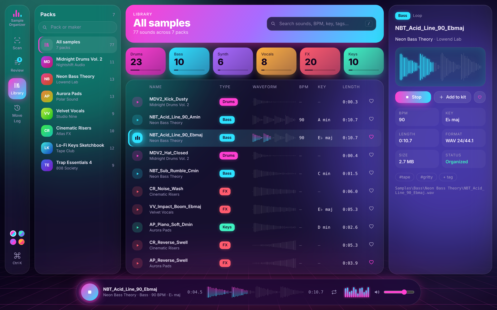

# UI plan: Prism Aurora

**This is the single design reference for the app's UI.** Every UI change,
new screen or restyle should match it. It replaces the earlier five concept
mockups, which have been removed.

Prism Aurora combines three earlier concepts:

- **Layout and shapes from Prism Bento:** rounded cards with gaps between
  them, a bold header card, a row of colored stat tiles and a floating
  player bar.
- **Colors and glow from Neon Synthwave:** a magenta-to-cyan accent
  gradient, glowing play buttons and a faint retro grid at the bottom.
- **Panels and background from Glass Aurora:** frosted see-through cards
  over soft teal and violet light.

The image shows the Library screen. Scan, Review and Move Log should use the
same tokens and components below.

## Color tokens

These map onto the existing CSS custom properties in `ui/app.css`.

| Token | Value | Use |
|---|---|---|
| `--bg` | `#09051a` | Page background (deep violet night) |
| `--panel` | `rgba(255,255,255,.05)` + `backdrop-filter: blur(26px) saturate(150%)` | Every card and panel |
| `--raised` | `rgba(255,255,255,.09)` | Buttons, hover and selected list items |
| `--field` | `rgba(255,255,255,.045)` | Inputs, meta boxes |
| `--line` | `rgba(255,255,255,.10)` | 1px card borders |
| `--text` | `#f6efff` | Main text |
| `--muted` | `#a59cc4` | Secondary text, labels |
| `--accent` | `#ff3fd2` (magenta) | Primary actions, playhead, active state |
| `--accent-2` | `#2de2ff` (cyan) | End of the accent gradient, loop state |
| `--on-accent` | `#14041f` | Text on solid category colors |

**Category colors** are used for tags, stat tiles, row play buttons and the
selected-row edge:

| Drums | Bass | Synth | Vocals | FX | Keys |
|---|---|---|---|---|---|
| `#ff3fd2` | `#2de2ff` | `#a86bff` | `#ffb13f` | `#ff5b6e` | `#3ff2c2` |

**Background:** two large blurred blobs (teal `#3ff2c2` at top left, violet
`#7b6cff` at right, roughly 40% opacity with a 110px blur), a magenta glow
along the bottom edge, and a faint magenta perspective grid that fades out
toward the top.

## Shapes and type

- Card corners are 24px, inner elements 14 to 16px, tags 8px, and the player
  bar and search fields are pill-shaped.
- The gap between cards is 14px.
- Font: Segoe UI Variable Display (falls back to Segoe UI), with tabular
  monospace numbers for BPM, key, length and time.
- Page title: 30px, weight 800. Body text: 13px.

## Components

- **Header card:** a 120° gradient from magenta through `#a86bff` to cyan,
  white text, and a dark frosted search field with a `/` shortcut hint.
- **Stat tiles:** one tile per category on a gradient of the category color,
  with dark text, the count at 26px weight 800, and a small progress bar.
  Clicking a tile filters the list, and the other tiles fade to 45%.
- **Rows:** 50px tall, rounded and borderless. The play button is a square
  tinted with the category color. A selected row gets a 4px left edge in the
  category color and a soft gradient wash.
- **Primary button:** the magenta-to-cyan gradient with a soft magenta
  shadow.
- **Rail:** icon buttons. The active one is filled with the accent gradient
  and glows.
- **Player:** a floating pill at the bottom center made of frosted glass,
  with a gradient play button with a glow ring, a waveform scrubber, loop,
  a spectrum visualizer and volume.
- **Accent picker:** four preset swatches in the rail let the user switch
  themes: magenta/cyan (default), teal/violet, violet/magenta and
  amber/pink.

## Motion (not visible in the image)

- Rows and cards fade and slide in, staggered by about 20ms each.
- The play button pulses its glow while playing, and the row shows animated
  equalizer bars.
- The playhead sweeps across the waveforms in the row, inspector and player.
- The spectrum visualizer reacts to the audio.
- Hover changes ease in over about 150ms.
- All motion turns off when Windows "reduce motion" is enabled
  (`prefers-reduced-motion`).

## Practical notes

- **Readability:** keep text on glass panels at `--text` or `--muted`; never
  use a lower contrast than that.
- **Performance:** `backdrop-filter` blur can be slow on older PCs. Offer a
  "Reduce effects" setting that swaps glass for solid `#160c2c` panels and
  hides the background blobs.
- **No dependencies:** the app runs offline, so use no web fonts or
  libraries. Everything here is plain CSS.
